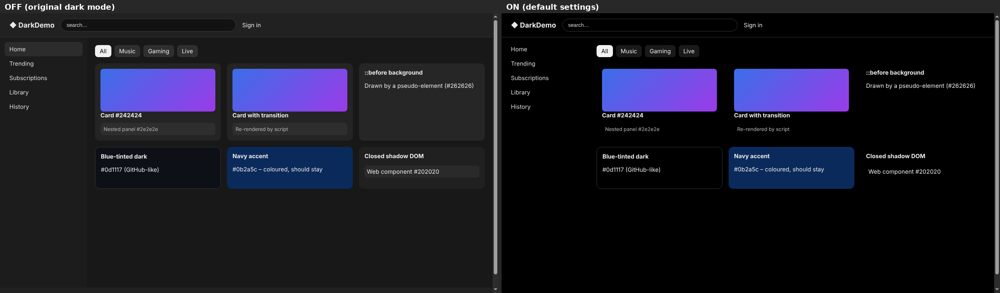
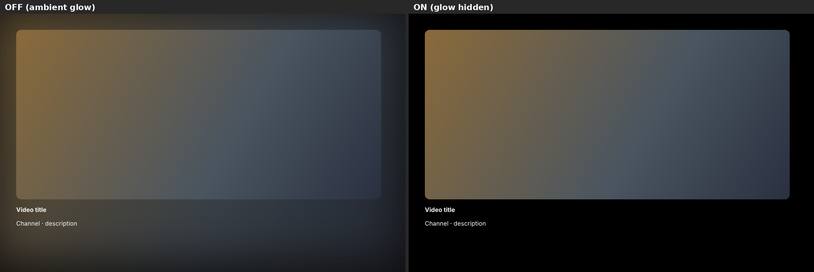
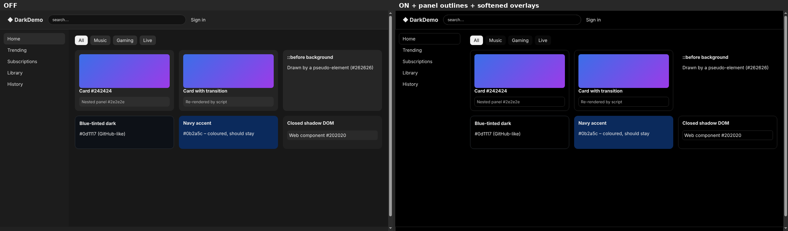
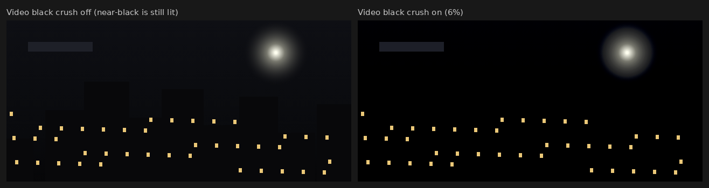
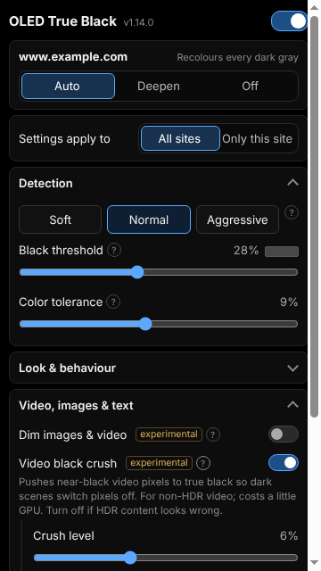
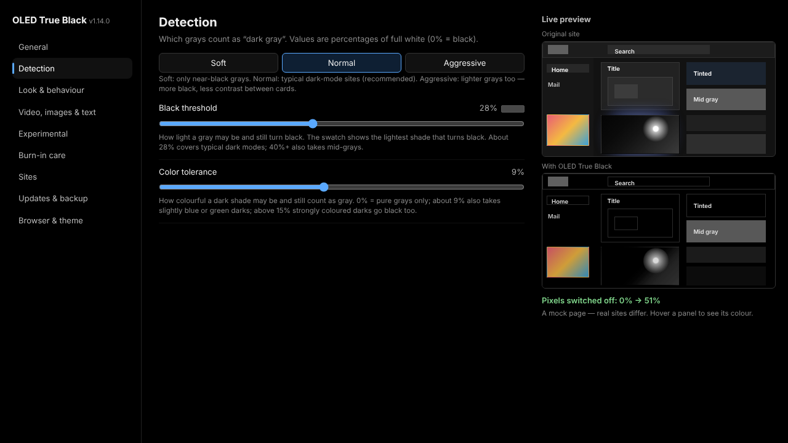

# OLED True Black

A browser extension for **Microsoft Edge, Google Chrome, Brave, Opera, Vivaldi and Firefox** that turns the dark-gray backgrounds of dark-mode websites into **pure black (`#000000`)**.

On an OLED screen a black pixel is switched off completely. Most dark themes use grays like `#121212`, `#181818` or `#212121`, so those pixels stay lit. Turning them black gives deeper contrast, uses less power and reduces burn-in on static UI.



*Left: a typical dark-mode layout. Right: the same page with the extension on. Gray panels go black, but the blue gradient thumbnails, the navy accent card and the light "All" chip keep their colours.*

The screenshots were taken in Chrome with the extension loaded, on the bundled [`demo.html`](demo.html) test page.

## Features

- **Detection by colour:** dark, near-neutral backgrounds turn black. Coloured areas, images, video and light pages are left alone.
- **Works on modern sites:**
  - web components (open and closed shadow DOM)
  - `::before` / `::after` background layers
  - dark gradients and modern colour formats (`oklch`, `lab`, `color-mix`)
  - content that loads after the page or changes later (infinite feeds, single-page apps)
- **Hides ambient glow:** blurred copies of a video drawn behind the player (for example YouTube's Ambient mode) are removed. They are images, not gray backgrounds, so the colour rule alone can't catch them. Tiny canvases stretched over a large area (YouTube Shorts' backdrop) are hidden too.

  

- **No gray flash:** sites that were dark last time are painted black immediately on the next visit.
- **Idle care (burn-in protection, off by default):** an untouched page first dims, then fades to black. Static logos, menus and text don't sit on the panel for hours. Any input wakes it, and the first click only wakes the page. It never triggers while a video plays (embedded videos included) or in background tabs. It can also hide a parked mouse cursor.
- **Update notice:** once a day the extension asks GitHub for the latest release. If there's a newer one, the icon shows **NEW** and the popup has a download link. Only the release version is fetched; nothing about you is sent. Turn it off in Settings → Updates. Browsers don't let unpacked extensions replace their own files, so installing the update is still manual.
- **Backup:** export all settings, including site lists, to a file and import them in another browser.
- **Site modes:** every site is **Auto** (recolour every dark gray), **Deepen** (only near-blacks turn pure black, nothing else changes) or **Off**. You can also run the extension *only on sites you list* instead of everywhere. A list entry such as `youtube.com` covers its subdomains.
- **Own settings per site:** switch the popup to "Only this site" and every look setting (thresholds, borders, outlines, dimming, video crush, text cap…) is kept separately for that site.
- **Report a problem with a site:** one button in the popup opens a pre-filled GitHub issue (site name, version, the settings used, what the extension did on the page). Nothing is sent until you press Submit, and no page content is included. Fixes that come out of these reports are shipped inside the next release (`extension/sitefixes.js`), below your own per-site settings.
- **Schedule:** run only during chosen hours (for example 20:00–07:00).
- **Performance mode and a timing readout:** the popup shows how many milliseconds the extension spent on the page and how many elements it checked. On a heavy page, Performance mode skips `::before`/`::after` and borders, works in smaller batches and ignores inline-style churn.
- **12 languages:** English, Bulgarian, Spanish, French, German, Italian, Portuguese (Brazil), Russian, Chinese (Simplified and Traditional), Japanese and Korean. The browser's language is used by default; pick another one in Settings → General. The translations are machine-written and unreviewed by native speakers, so corrections are welcome (see [Contributing](#contributing)).
- **Redesigned popup and settings:**
  - the popup has collapsible sections with sub-settings that fold open, a sliding Auto / Deepen / Off switch and tap-to-read hints, so everything can be changed on the fly
  - the settings page has a sidebar on the left and a **live preview** on the right: a mock page shown as the original and with your settings applied, with the share of pixels switched off. It uses the same decision code as the real extension
- **Optional black browser frame:** a separate theme for the tabs and toolbar.
- **Quick toggle:** `Alt+Shift+B`.

### Experimental options



- **Panel outlines:** keeps a thin line where a gray panel used to be, so nested panels stay readable.
- **Soften light overlays:** makes faint white tints (description boxes, chips) closer to black.
- **Hover hint:** buttons and list rows light up faintly when you point at them.
- **Translucent dark layers:** also catches partly see-through dark grays.
- **Dim images & video:** slightly darkens pictures and videos so they don't glare against the black page.
- **Video black crush:** video is rarely encoded with true black. Dark scenes sit at 3–10% brightness, so those pixels stay lit. This applies a tone curve (an SVG filter on the `<video>` element): everything at or below the level goes to `#000`, everything above twice the level is untouched, and it blends smoothly in between. Meant for non-HDR video. It costs a little GPU and may stop the browser from using hardware video overlays, so it is off by default. Turn it off if HDR content looks wrong.

  

  *A synthetic night scene drawn the way a video encoder would: with crush on, 72% of the pixels are exactly `#000` instead of 0%. The lit windows and the bright light are untouched.*
- **Soften bright text:** caps near-white text a little below pure white (default 88%) to reduce glare and halation on black. Only elements with their own text and a solid colour are changed.
- **Inspector:** hold `Alt` and move the mouse. It shows the site's original colours, where the visible background comes from, whether it turns black (and if not, why), and what is on screen now.
- **Debug:** paints detected areas burgundy instead of black.

| Popup | Settings |
|---|---|
|  |  |

## Install

All downloads are on the **[latest release](https://github.com/NGGKroze/oled-true-black/releases/latest)** page.

### Edge, Chrome, Brave, Opera, Vivaldi

1. Download **[OLED-True-Black-v1.14.0-chromium.zip](https://github.com/NGGKroze/oled-true-black/releases/download/v1.14.0/OLED-True-Black-v1.14.0-chromium.zip)** and unzip it.
2. Open `edge://extensions` (or `chrome://extensions`) and turn on **Developer mode**.
3. Click **Load unpacked** and select the **`extension`** folder.
4. Optional: repeat step 3 with the **`theme`** folder for a black browser frame. A theme and an extension can't share one package.

To update: download the new zip, replace the old `extension` folder with the new one, then click **Reload** on the extension. Your settings are kept. For local `file://` pages, turn on **Allow access to file URLs** in the extension's details.

### Firefox (140 or newer)

- **From Firefox Add-ons:** once the listing is approved, install it from addons.mozilla.org like any other add-on.
- **Try it now (temporary, removed when Firefox restarts):**
  1. Download **[OLED-True-Black-v1.14.0-firefox.zip](https://github.com/NGGKroze/oled-true-black/releases/download/v1.14.0/OLED-True-Black-v1.14.0-firefox.zip)**.
  2. Open `about:debugging#/runtime/this-firefox` and click **Load Temporary Add-on…**.
  3. Select the downloaded zip.
- **Black Firefox frame (optional):** [OLED-Black-Theme-firefox.zip](https://github.com/NGGKroze/oled-true-black/releases/download/v1.14.0/OLED-Black-Theme-firefox.zip) is a separate theme for the tabs, toolbar, menus and sidebar.

Regular Firefox only keeps add-ons that Mozilla has signed, which is why the permanent install goes through addons.mozilla.org.

## Settings

All brightness values are a percentage of full white (0% = black, 100% = white).

| Setting | Default | What it does |
|---|---|---|
| Black threshold | 28% | The lightest gray that still turns black. A swatch shows that shade. |
| Color tolerance | 9% | How coloured a dark shade may be and still count as gray. 0% means pure grays only; 9% also catches blue-tinted darks like `#0d1117`. |
| Presets | Normal | **Soft** (20% / 6%): near-black only. **Normal** (28% / 9%). **Aggressive** (43% / 13%): also mid-grays. |
| Black borders | off | Also turns thin dark-gray border lines black. |
| Pseudo-element backgrounds | on | Catches backgrounds drawn with `::before` / `::after`. |
| Hide blurred glow behind videos | on | Hides large blurred canvas/video/image layers (blur ≥ 8px). The real video is never touched. |
| Idle care | off | Dim after 2 min, black out after 5 min (0 = stage off), dim strength 60%, hide cursor after N s (0 = off). |
| Prevent gray flash | on | Remembers dark sites and paints them black before the page has been scanned. |
| Performance mode | off | Lighter scanning for heavy pages (see Features). |
| Site mode | Auto | Per site: Auto / Deepen (only grays up to 11%, tolerance 3%, no extras) / Off. |
| Run on | all sites | Everywhere except the sites you turn off, or only the sites you list. |
| Schedule | off | From / until, local time. Overnight ranges such as 20:00–07:00 work. |
| Video black crush | off | Level 1–15% (default 6%). |
| Soften bright text | off | Maximum text brightness 60–100% (default 88%). |

## How it works

```
page loads ──► content script (document_start)
                 │
                 ├─ MAIN-world script patches attachShadow → closed shadow roots become reachable
                 ├─ known dark site? → temporary  html,body { background:#000 }
                 │
                 ├─ scan every element in batches of 250, once per animation frame:
                 │     1. remove its old mark (with transitions off) → read the site's real colour
                 │     2. getComputedStyle → background, ::before/::after, borders
                 │     3. decide → set attributes:  data-oled-black, data-oled-pseudo, …
                 │
                 ├─ one injected stylesheet per document / shadow root:
                 │     [data-oled-black] { background-color:#000 !important; background-image:none !important }
                 │
                 └─ MutationObserver → re-check only added or changed elements
```

### The detection rule

For a computed background colour `rgb(r, g, b)` with opacity `a`:

```
max = max(r, g, b)
min = min(r, g, b)
turns black  ⇔  a ≥ 0.9  and  0 < max ≤ threshold  and  max − min ≤ tolerance
```

- **`max ≤ threshold`:** the colour is dark enough.
- **`max − min ≤ tolerance`:** the colour is close to neutral gray. Navy (`#0b2a5c`, difference 81) keeps its colour.
- **`a ≥ 0.9`:** translucent scrims and overlays are skipped, so content behind them stays visible.
- **Background images:** an element whose background is a real image (`url(…)`) keeps it. Thumbnails aren't wiped.
- **Gradients:** removed only if every colour stop is a dark gray.
- **Transparent page root:** a transparent `<html>` that declares `color-scheme: dark` paints a gray canvas, so it is set to black too.

### How it fits into pages

- **Wins against site CSS:** every rule carries extra specificity (`:not(#oled-x):not(#oled-x)`), so site rules like `html[dark]{background:#0f0f0f !important}` can't bring the gray back.
- **No inline style changes:** the extension only adds `data-oled-*` attributes plus one small stylesheet. The page's own styles and scripts are untouched, and turning it off removes every trace instantly.
- **Theme switches and re-renders:** when a site changes classes on an element, the extension re-checks it.
  - Before reading the colour again, it briefly adds `transition: none`. Otherwise a background transition would report the in-between black, and the element would fade back to gray.
  - Sites restyle elements constantly. Inline style changes that can't affect a background (transforms, animations) are ignored.
- **Shadow DOM:** each shadow root gets its own copy of the stylesheet and its own observer.
  - Closed roots are made reachable by a small script that runs in the page itself and patches `attachShadow` before the site's code runs.
- **Speed:** colours are parsed once and cached, the work is split into frame-sized batches, and the mouse listener for the inspector exists only while the inspector is on.

## Limitations

- **Browser-internal pages:** `edge://` and `chrome://` pages, the built-in PDF viewer, extension stores and the browser sidebar can't be reached by extensions.
- **Hover states:** gray hover and highlight colours on recoloured elements turn black too. Use **Hover hint** to bring back a faint highlight.
- **Images and canvas:** backgrounds drawn as images, on `<canvas>`, or in `<video>` aren't changed.
- **Closed shadow DOM:** forcing closed shadow roots open could, rarely, confuse a widget. Turn the extension off for that site from the popup.

## Project layout

```
extension/
  manifest.json          Manifest V3 (Chromium)
  manifest.firefox.json  Manifest V3 (Firefox: background script, add-on ID)
  core.js           defaults + pure helpers shared by everything (site modes, schedule, detection predicates, video-crush curve)
  content.js        detection + recolouring (isolated world)
  idle.js           idle dimming / blackout, cursor hiding
  main-world.js     attachShadow patch (page world)
  sitefixes.js      built-in per-site fixes (filled from "Report a problem" issues)
  background.js     keyboard shortcut, OFF / NEW badge, daily update check
  i18n.js           translation loader (own language picker on top of chrome.i18n files)
  controls.js       the settings controls, shared by popup and settings page
  popup.*           toolbar popup
  options.*         settings page; preview.js is the live preview
  newtab.*          black new-tab page
  ui.css            shared styles
  _locales/<code>/messages.json   translations (en is the fallback)
theme/
  manifest.json     black browser frame for Chromium browsers (optional)
theme-firefox/
  manifest.json     black browser frame for Firefox (optional)
build.py            builds the install zips into dist/ (attached to each GitHub release)
demo.html           test page used for the screenshots
demo-glow.html      ambient-glow test page
demo-shorts.html    Shorts-like test page (stretched canvas, !important site rule)
```

Don't want the black new-tab page? Delete the `chrome_url_overrides` block from `extension/manifest.json`.

## Contributing

- **Translations:** each language is one file, `extension/_locales/<code>/messages.json`. Missing keys fall back to English, so partial fixes are fine. Keep the `{0}`, `{1}` placeholders. Native-speaker corrections are especially welcome.
- **Sites that don't look right:** use **Report a problem with this site** in the popup. If you already know the settings that fix a site, add an entry to `extension/sitefixes.js`:

  ```js
  "example.com": { threshold: 50, borders: true },
  ```
- **Tests:** there is no test framework in the repo. Changes are checked by loading the unpacked extension in Chrome (Playwright works) against `demo*.html`.
